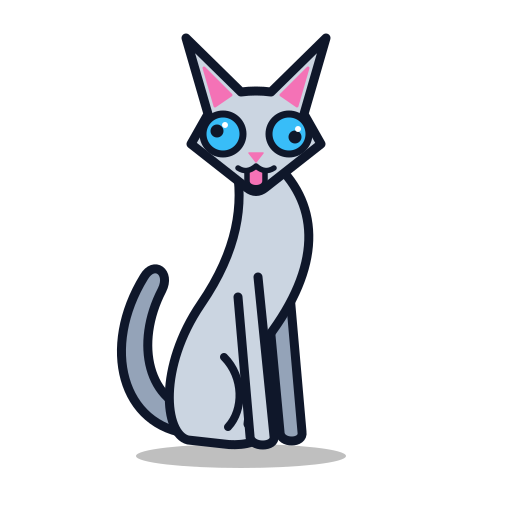

  

<h1 align="center">The Scatty Language Project Assets</h1>

  Official visual assets, mascot illustrations, and icons for the Scatty programming language.

## Allowed Use

You are welcome and encouraged to use the mascot and brand assets in the following contexts:

* **Editor and IDE Extensions:** Including the icon in plugins for VS Code, JetBrains IDEs, Neovim, Sublime Text, or other tools to associate with `.cat` source files.
* **Educational Materials:** Using the mascot in presentations, slide decks, documentation, articles, books, tutorials, and videos discussing the language.
* **Community and Fan Art:** Creating adaptations, alternative poses, memes, avatars, and sticker packs for messaging platforms (Telegram, Discord, Slack, and etc.).
* **Community Merchandise:** Printing stickers, badges, or t-shirts for local meetups, conferences, and user groups.

## Restrictions

To protect the identity of the language, the following uses are prohibited:

* **False Affiliation:** Do not use the mascot or logo in a way that implies an unofficial project, fork, library, or company is officially endorsed by or part of the Scatty Core Team.
* **Trademark Registration:** Do not register or attempt to register the mascot, logo, or name as your own trademark or proprietary asset.
* **Unrelated Commercial Products:** Do not use the mascot as the primary branding or logo for unrelated commercial software, services, or products.

## Attribution Requirement

Under the CC BY 4.0 license, attribution is required when distributing or creating derivatives of the mascot. You can satisfy this requirement by including the following notice in your project's `README` or documentation:

> The Scatty Cat mascot was created by T.B.B (aka. zTBBz) and is licensed under CC BY 4.0.
