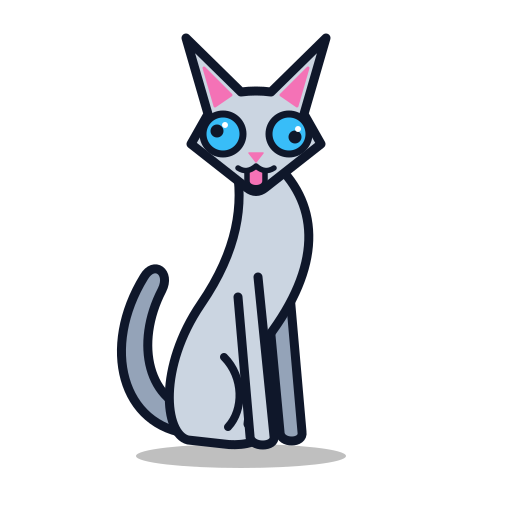

  

<h1 align="center">The Scatty Language Project Assets</h1>

  Official visual assets, including the mascot, emblems, logos, icons, and other graphics for The Scatty Language Project.

## Allowed Use

You are welcome and encouraged to use any of the assets in this repository in the following contexts:

* **Editor and IDE Extensions:** Including the icons, emblems, and logos in plugins for VS Code, JetBrains IDEs, Neovim, Sublime Text, or other tools to associate with `.cat` source files.
* **Educational Materials:** Using the visual assets in presentations, slide decks, documentation, articles, books, tutorials, and videos discussing the language.
* **Community and Fan Art:** Creating adaptations, alternative poses, wallpapers, memes, avatars, and sticker packs for messaging platforms (Telegram, Discord, Slack, etc.).
* **Community Merchandise:** Printing stickers, badges, t-shirts, or other swag for local meetups, conferences, and user groups.

## Restrictions

To protect the identity of the project, the following uses are prohibited:

* **False Affiliation:** Do not use the mascot, emblem, logos, or any other assets in a way that implies an unofficial project, fork, library, or company is officially endorsed by or part of The Scatty Language Project.
* **Trademark Registration:** Do not register or attempt to register any assets from this repository or the project name as your own trademark or proprietary asset.
* **Unrelated Commercial Products:** Do not use these assets as the primary emblem, logo, or visual identity for unrelated commercial software, services, or products.

## Attribution Requirement

All files and visual assets in this repository are licensed under the CC BY 4.0 license. Attribution is required when distributing, using, or creating derivatives of any asset found here. You can satisfy this requirement by including the following notice in your project's `README`, documentation, or credits:

> The Scatty Language Project visual assets were created by T.B.B (aka. zTBBz) and are licensed under CC BY 4.0.
